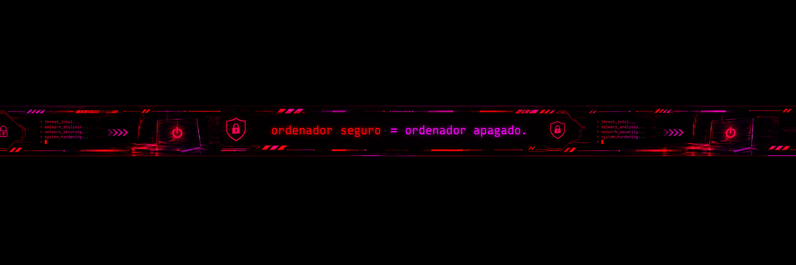

<h1 align="center"> Leonardo Pacheco</h1>

  <strong>Cybersecurity & networks · Cloud Security · Linux · Open Source</strong>

  Building secure systems and talk of technology through securitytech.

Self-taught in Cybersecurity | Linux, Networking, and Python | Project development and hands-on labs. 
Based in Lima , Perú.Interested in understanding how applications work from the ground up, exploring system defense and vulnerability analysis.

## Current role & focus
Network Security - Linux and System Administration - Web Application Security - Linux and System Administration - Python for Security Automation
## Projects & open source
Coming soon ...
<h2>Featured work</h2>

<table width="100%">
<tr>
<td width="58%" valign="top">

</td>
<td width="42%" valign="top">
<h3><a href="https://github.com/octocat/Spoon-Knife"><strong>Spoon-Knife</strong></a></h3>

This repo is for demonstration purposes only.

HTML · ⭐ 14,124 stars · 160,240 forks

<a href="https://github.com/octocat/Spoon-Knife">View project →</a>

</td>
</tr>
</table>
<h2>Activity</h2>

  <picture>
    <source media="(prefers-color-scheme: light)" srcset="https://www.gitskins.com/api/section/heatmap?username=octocat&theme=aurora&avatar=https%3A%2F%2Favatars.githubusercontent.com%2Fu%2F583231%3Fu%3Da59fef2a493e2b67dd13754231daf220c82ba84d%26v%3D4&mode=light" />
    
  </picture>

<table width="100%">
<tr>
<td width="62%" valign="middle"><h2>Let’s build something</h2>
Open to thoughtful collaboration, ambitious products, and useful open-source work.
</td>
<td width="38%" valign="middle" align="right"><a href="https://github.com/octocat">GitHub</a> <a href="https://github.blog">Website</a></td>
</tr>
</table>

## Technical toolkit
Technologies for TI 🖥️   &   🛡️ Cibersegurity

  **Backend & Data**

  
  
  

  **Cloud & DevOps**

 
  
  

  **Systems, Networking & Security Labs**

  
  
  
  
  
 

**Other Technologies**

  
   
  
  
  

## Learning & Certifications

- **SYSTEMS DEVELOPMENT**, Instituto Simón Bolivar - a cycle, retired Dec. 2024
  > **Hack The Box Academy** — Cybersecurity training 
  
  > **Cisco Networking Academy** — Networking fundamentals 

   

  
   

<h2 align="center">Connect with me</h2>

    
   
  
    

  Lima, Perú · UTC-5

