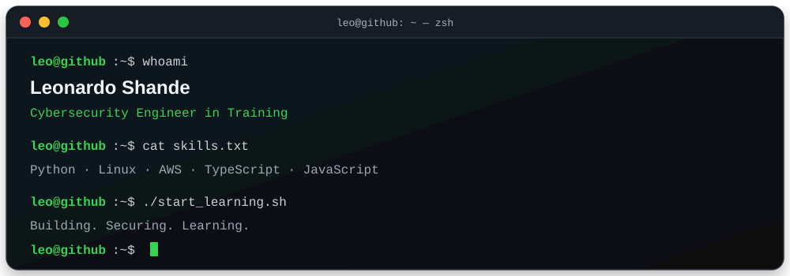

<h1 align="center"> Leonardo Pacheco</h1>

  <strong>Cybersecurity & networks · Cloud Security · Linux · Open Source</strong>

  Building secure systems and talk of technology through securitytech.

Self-taught in Cybersecurity | Linux, Networking, and Python | Project development and hands-on labs. 
Based in Lima , Perú.Interested in understanding how applications work from the ground up, exploring system defense and vulnerability analysis.

## Current role & focus
Network Security - Linux and System Administration - Web Application Security - Linux and System Administration - Python for Security Automation

  

  

## Projects & open source

<table>
<tr>
<td width="50%">
<h3> QubitGuard</h3>
Quantum Cybersecurity Dashboard

Python · Qiskit

</td>

<td width="50%">
<h3> Python-Security-Lab </h3>
cybersecurity lab

HTML · python · JavaScript

</td>
</tr>

</table>
---

#MORE PROYECTS COMING SOON ...

<!--separator -->

  

<!--sepaator -->

## Technical toolkit
Technologies for TI 🖥️   &   🛡️ Cibersegurity

  **Backend & Data**

  
  
  

  **Cloud & DevOps**

 
  
  

  **Systems, Networking & Security Labs**

  
  
  
  
  
 

**Other Technologies**

  
   
  
  
  

## Learning & Certifications

- **SYSTEMS DEVELOPMENT**, Instituto Simón Bolivar - a cycle, retired Dec. 2024
  > **Hack The Box Academy** — Cybersecurity training 
  
  > **Cisco Networking Academy** — Networking fundamentals 

<h2 align="center">Connect with me</h2>

    
   
  
    <a href="mailto:leonardoshande.p@gmail.com">
    

  Lima, Perú · UTC-5

  

